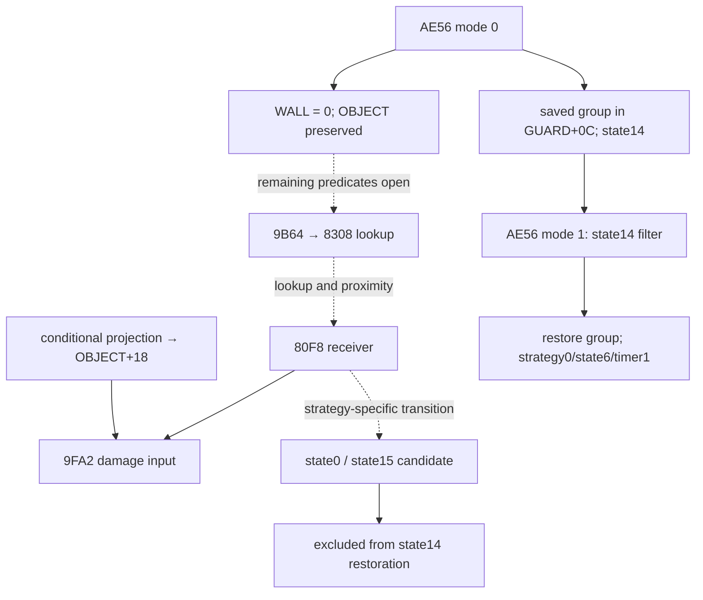

# E1M9 radio: static writer → reader lifecycle

Audit date: 2026-10-18. Base: `1d47c86` (main already v0.42).
Scope: repository-only static analysis. No EXE, MAP/IMG bank, complete decompiler export or instruction XREF export was available in this checkout. Addresses below are inherited evidence locators, **not freshly verified instructions**. No original program was executed. Confidence is high for consistency of the bounded contracts with cited reports, medium for original behavior pending primary-artifact revalidation.

## Finding

For audited Win16 1.3–1.10, AE56(0)'s local map write clears WALL, preserving OBJECT. This removes one proposed obstruction to projectile property lookup; it does not prove a hit. GUARD+0C must not be represented as an unconditional nextstate or unconditional saved group: its interpretation depends on the writer and current path. AE56(1) restores only state14 records.

## Evidence graph

“Reported” means explicitly supported by the cited repository evidence; it does not claim a complete global census. Function-level addresses are not promoted to exact store offsets. Win16 v1.10 `3:` addresses do not automatically apply to other builds. Rows marked OPEN are deliberately incomplete edges.

| Field / destination | Writer → reader | Condition and effect | Status / source |
|---|---|---|---|
| GUARD+08 | allocator/initializer → OBJECT resolution → AE56 / projection / receiver | allocated OBJECT slot; resolve with 28-byte stride, not a class-definition index | Reported: V041 §2; GUARD_AI_RE §layout; nite3w_ai_state_machine correction |
| OBJECT+0C/+0E | loader → AE56(0) dereference | far pointer to WALL byte of map cell, segment relocation supported across 12 builds | Reported: V041 §1–2; exact loader stores absent |
| MAP WALL | AE56(0) indirect `ES:[BX]=0` → map wall consumers | Win16 1.3–1.10 only; adjacent OBJECT 86/91/95 preserved locally | Reported: V041 §1; not equivalent to changing runtime OBJECT class |
| MAP OBJECT | surviving OBJECT ID → property lookup in 9B64 → 8308 lookup | guard-property branch remains possible; successful lookup and preceding wall branches still required | Reported call chain: Nitemare3D_neznáme_hlbkový_audit §projectile; V041 §1. Full predicate/lookup algorithm OPEN |
| GUARD+0C | AE56(0): old OBJECT+04 → AE56(1): OBJECT+04 | saved original resource group (17/9/5 for the original actors); read only for records still state14 | Reported: V041 §2; Gameplay_closure_pass_4 §3, corrected WALL statement |
| GUARD+00 / OBJECT+03 | special initializer descriptor word → sequence/frame readers | class09/0B/0C selects descriptor word +04/+24/+14; full word to GUARD+00, low byte to OBJECT+03 | Reported: V041 §2; downstream global frame bounds OPEN |
| OBJECT+04 | AE56(0) class21 donor replacement → animation/projection; AE56(1) saved-group restoration | donor is runtime resource selector, not universally a numeric class ID | Reported: V041 §2; Gameplay_closure_pass_4 §3 |
| GUARD+0B/+06 | activation → state14 handler 3:804A | state14, timer112; 16 no-move updates, 96 movement updates; next invocation stops globally | Reported: V039 §2; N3DV039LateStaticClosures.hpp |
| GUARD+0B | state14 expiration → AE56(1) scan/filter | only state14 restored: strategy0/state6/timer1; ascending scan can expose later records to state6 in same pass | Reported: V039 §2; external mutation/reentry not proven absent |
| OBJECT+18 | projection 3:CC7C, store 3:CE5E → damage 3:9FA2, read 3:9FAE | cached projected row; pre-class scalar low16(8*(row-base)+RNG%25) | Reported: OBJECT_GUARD_field_read_write_closure; V041 §6 |
| GUARD+02/+04 | projection 3:CE98–CE9D → hitscan 3:8B61 | generation equality required in weapon scan, then state/LOS filters | Reported: field closure; V041 §6. Equality alone is not a whole-program freshness proof |
| OBJECT+18 | last projection/other writer → 9B64→80F8→9FA2 | projectile proximity abs(dx)<10 AND abs(dy)<10; no equivalent local generation gate shown | Reported: projectile_pool §collision; field closure. Last reaching definition OPEN |
| GUARD+0C/+0B | ordinary nonlethal receiver 3:8290/8297 → state15 return 3:807E | old nonzero state copied to +0C (test 8282), state15 then reads nextstate | Reported: V032 §2 / V025 addendum; do not assume this is every strategy-specific radio-hit branch |
| GUARD+0C/+0B | strategy2 nonlethal transformed hit → stop filter | can overwrite saved byte and leave state0; state0 then skipped by state14-only restore | Reported conditional outcome: V039 §2. Exact path/store order not present; natural hit OPEN |
| all requested fields | movement, removal, LOAD/bulk copy, indirect aliases → all readers above | may change cell binding, slot association, saved group, projection cache or state | OPEN: no exhaustive XREF/alias listing in checkout |

Solid arrows summarize reported local contracts, not unconditional execution. Dotted arrows require unresolved guards/reachability.

## Branch separation and corrected assumptions

1. Radio entry B010 is E1M9-specific (episode1, zero-based level8); activation includes UI/story/audio work before guard processing. ACTIONSPOT wall selection still needs its precise property/class predicates. Clearing WALL cannot be equated with deleting the runtime OBJECT or its GUARD association.
2. Win16 1.0 lacks the same local WALL clear. Repeated activation may save the borrowed group, but a legal second activation is not established. The new wrapper intentionally covers only 1.3–1.10.
3. Hitscan and projectile routes share damage but not the documented local generation gate. Do not add a freshness rejection to projectile collision merely to make the port cleaner.
4. Ordinary pain entry and strategy2 transformed-hit outcome are separate branches. Do not apply `+0C=oldState; state=15` unconditionally to all radio hits. A saved Skeleton group9 is not proof that state9 is naturally executed.
5. State14 expiration is a global scan, not a per-actor restore. An actor already outside state14 remains outside this local restore even if +0C still holds a plausible group.
6. The graph includes the lethal/zero-damage/class dispatch boundary as unresolved receiver branches: positive damage, HP comparison, class transforms and selector termination must be checked before inferring a nonlethal outcome. No complete receiver is implemented here.

## Concrete implementation and regression scope

`E1M9RadioLifecycle.hpp` adds a build-scoped map-write wrapper, exact supported descriptor offsets and a state-filtered restore field slice. It reuses existing v039/v041 contracts. It does not invent missing loader, movement, hit acceptance or damage dispatch behavior. `savedGroupOrNextState` makes the field overload explicit without changing the original ABI. No change to the playable engine is justified by these partial facts.

The test checks every WALL/OBJECT byte combination, every GUARD state against the restore filter, class09/0B/0C mapping, and supplied state0/state15 counterexamples. These are synthetic contract regressions, not original-binary tests and not proof a hit is reachable. Restoring group9 from state14 and skipping group9 from other states catches both the old deletion assumption and an unconditional saved-group restoration bug.

Historical `Gameplay_closure_pass_4` now says WALL. The early `analysis/nite3w_guard_record.md` definition-index interpretation is explicitly superseded. Earlier reports calling cache freshness necessarily a runtime question should be read as unresolved at the time, not a proof static closure is impossible.

## Remaining static work before runtime

| Question | Required static evidence / discriminating analysis |
|---|---|
| Complete pointer lifecycle | Fingerprinted Win16 EXE + full loader, movement, deletion, LOAD and helper disassembly; track both +0C and +0E, segment fixups, pointer arithmetic, destination aliases and overlapping bulk copies. Distinguish world OBJECT from projectile embedded OBJECT (slot+0E). |
| Stable GUARD association | Enumerate every +08 store, compaction/reuse and LOAD writer; inspect 8308 matching algorithm and all failure exits. Slot stride is not identity/lifetime proof. |
| Saved group vs nextstate | Enumerate all +0B/+0C direct and aliased stores, order receiver branch guards, selector loops and state0/15 readers; include lethal, zero damage, reactivation and restore paths. |
| Last OBJECT+18 writer | Whole-program reaching definitions through culling returns, constructor initialization, LOAD, slot reuse, nested callbacks and projection. Do not infer no write from a missing local store. |
| Natural accepted hit | Matched E1M9 MAP+IMG+OBJECTS/WALLS and exact control flow for legal key/door/secret/radio/UI route, TRIGGER2/jam, FIRE cadence/ammo/pool, wall-first collision branches, lookup, proximity and receiver/selector completion. A preserved property byte is only one conjunct. |

None of these missing static inputs is evidence of inherent runtime-only behavior. Runtime is reserved for residual external input/interrupt/UI chronology or a concrete timing ambiguity after static closure, and later parity validation. No runtime request is needed to continue the static census once primary artifacts are available.

## Confidence

High for bounded model consistency and the identified documentation contradictions; medium for inherited original-code claims; unknown for complete writer census and a naturally accepted E1M9 radio-state projectile hit. No parity percentage is raised.

## Validation performed

Direct g++ C++20 build with `-Wall -Wextra -Wpedantic -UNDEBUG`: new E1M9 test, existing v039 late-static and v041 latest-static tests all passed. Existing v041 Python suite: 5/5 passed. `git diff --check` passed. Full CMake/CTest was not run locally because cmake is unavailable; the new target is registered and included in the existing CI build/test workflow.
