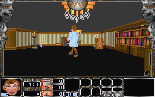

# DOS2: prvý scheduler návrat, VGA svet/HUD a zostávajúce UNKNOWN medzery

Nový prirodzený original-EXE scenár po inicializácii epizódy1/level index0/difficulty1 vykonal **0BDE:03C8 od vstupu až po FAR návrat do0D29:16EA**. Pôvodný scheduler prešiel oboma due-bucket vetvami, world-update skupinou, synchronizovaným VGA flipom a zápisom troch deadline DWORD. Aktuálny viditeľný VGA plane snapshot sa dá zrekonštruovať ako320×200 herný pohľad so spritom a HUD.

Je to **PARTIAL runtime dôkaz**, nie DEEP VERIFIED celej hry, dlhodobej kadencie, všetkých scheduler vetiev, AI, damage alebo nezávislej pixel parity. Počet zachovaných original-EXE scenárov22→23; bounded katalog143funkcií/5708inštrukcií/14344B a994017 controlled replay prípadov zostáva nezmenený. Existujúca scheduler funkcia ani jej už typované12B deadline dáta sa nesčítavajú znovu.

PASS320 **57118B PARTIAL /149B CLASSIFIED ONLY /28B UNKNOWN /0B DEEP VERIFIED**, presne57295B, bez zmeny. Mapa `pass1_xms_move_request/noncode_intervals.csv` SHA497d10a11959dbae3d17f495e803569e229c13434658ec94c231d29784f47efe ostáva aktuálna.

## Aktivácia až po načítaní mapy

Frozen harness `runtime_watch_scheduler.py` zachováva predchádzajúci Newgame input a map-init breakpointy. Scheduler body breakpointy sa inštalujú až po0D29:0A31, ktorý je **pre-music-selector call083D:288C**, nie vstup do hernej slučky. Nasleduje zachovaný návrat game-start caller0D29:281A. Tak sa prvý následný scheduler vstup nezamieňa za staršie intro/menu použitie.

Skutočný caller má instruction0D29:16E5 FAR CALL0BDE:03C8 a return0D29:16EA. Natívny load0824h dáva scheduler CS1402h, caller CS154Dh, DS=SS2F95h. Pri vstupe je SP E7D0h; zachovaný FAR frame je16EA:154D v pamäťovom poradí offset/segment. Pred RETF je SP aj frame rovnaký, po návrate SP E7D4h. BP sa v tomto natívnom harness nečítal, preto sa jeho zachovanie neopiera o tieto runtime registre; existujúci riadený replay má samostatný BP test.

68 code-breakpoint stavov zahŕňa14 scheduler stavov.342 raw capture súborov je pripnutých manifestom; všetkých23 vstupných súborov aj izolované kópie sa hashovo zhodujú. Codebreakpointy prerušujú vykonávanie a môžu meniť časovanie. Emulované clock hodnoty z tohto behu preto neznamenajú18ms garantovanú kadenciu pri neprerušenom behu alebo pôvodnom hardvéri.

## Presný priebeh pôvodného tela

|Scheduler bod|Potvrdenie|
|---|---|
|03C8 entry|last raw sample0, next bucket8=0, next config bucket=0; world counter1|
|03D0 cached T0|DX:AX=12843|
|03DA raw R0|DX:AX=3515327978 (`D187A5EAh`)|
|03EB bucket8 return|DX:AX=1; deadline0 je due|
|0410 after tick8|mode WORD3CD6=0, pôvodná vetva vykonala tick_action0370|
|0425 configured bucket return|DX:AX=1; next8 už2, config deadline0 je due|
|0454 world-group begin|current buckets DS3672/3676=(1,1)|
|0470 world-group return|pôvodné callee sa vrátili; DWORD4540 sa zmenil1→2|
|0474 cached T1|DX:AX=12861|
|0483 sync flip call|AX=18,DX0; unsigned elapsed18 <65|
|048F flip returned|page WORD012C/012E: A400/A000 → A000/A400|
|04A6 deadline writes done|DWORD1734/1738/173C=R0/2/2|
|04D5 RETF a caller16EA|deadline aj page stavy zachované; FAR frame a SP uzavreté|

Raw sample R0 sa nesmie zamieňať s cached millisecond T0/T1. Rozdiel T1−T0 sa overuje modulo2^32 a zhoduje sa s pôvodným SUB/SBB výsledkom v bode0483. Deadline fallback test `(R0-last_raw)&FFFFFFFF >500` má po zápise last_raw=R0 rozdiel0; táto zaznamenaná cesta preto nepotrebuje fallback poll1/poll0. Nejde o runtime dôkaz tejto chybovej/timeout vetvy.

Native callees world skupiny sa v tomto DOSBox behu nenahrádzali stubmi:0BDE:02F8,0BDE:0156,083D:1CE8,083D:1E66,0000:0AEA a07ED:0360 sa vrátili pred0470. Tento zachovaný caller priebeh neuzatvára ich všetky ASM vetvy ani nepriraďuje bez ďalších vnútorných breakpointov konkrétnemu callee každý vedľajší účinok. Post-update BYTE/WORD vstupná cesta06B0:05D6 sa vrátila pred deadline zápismi. Bez nového gameplay key input sa nepreukazuje celá jej doména.

Existujúce statické telo scheduler[0C1A8,0C2B6)270B/92inštrukcií a5760 mocked dependency replay prípadov ostáva referenciou v PASS1_SCHEDULER_REPORT.md. Nový dôkaz pridáva reálnu jednu vykonanú cestu, nie nové replay prípady ani druhý katalogový funkčný rozsah.

## Viditeľná VGA stránka a odvodený obraz

Po návrate je latched aj programmed display-start0h, pel-pan0, teda aktuálna stránkaA000. Read-map0 plane capture plus ďalšie tri planes majú spolu64000 pixel indexov. Používajú179 farieb. SHA pixel indexov je `04e81a62fcdb6a60bcafe99d06aa5010b0b640f3bcce5601679cd15da36a7ed1`. Druhá A400 stránka má odlišný pixel hash a tiež179 použitých farieb; ich identita sa nepredpokladá.

Obraz vzniká prekladaním plane indexu `p=n%4` a offsetu `n//4`, s aktuálnym6-bit DAC a škálovaním255/63. Je to reprodukovateľná vizualizácia zachyteného VRAM stavu po prvom scheduler návrate: world view, sprit a HUD sú viditeľné. Nie je to host screenshot, nezávislý pixel golden ani dôkaz historicky správneho monitorového scanoutu. Neoznačuje sa za prvý fyzicky zobrazený frame celej session. Žiadna nová binárna originálna herná asset sa týmto PNG nepublikuje.

Plane dump sa vykonal po koncovom bode s CPU zastaveným. Debugger výslovne mení GC read-map pre plane readback a následne obnoví read-map aj GC index; GC/SEQ/MODE/AC stavy pred/po sa zhodujú. VGA read latches a ich úplné obnovenie sa nepreukazujú; po takomto čítaní sa hra už ďalej nespúšťala.

## Nová nezrovnalosť DAC oproti RAM palete

V startup/main-menu stave bol DAC rovný DS:4A64 RAM palete. V tomto novom endpointe to neplatí pre **farby227 a235**. Aktuálny DAC má obe RGB trojice000000, RAM stále(26,5,21) a(36,6,29). Šesť konkrétnych rozdielov sú indexy komponentov681..683 a705..707; ostatných762/768 komponentov sa zhoduje. Vo viditeľných64000 pixel indexoch má každá z týchto dvoch farieb výskyt0.

PNG zámerne používa skutočný DACPAL readback, nie staršiu RAM kópiu. Zmena je potvrdený stavový rozdiel, **jej writer a účel ešte nie sú potvrdené**. Nemožno ju bez port-write trace nazvať palette animation, poškodením ani dôsledkom jedného konkrétneho update callee. Ide o nový konkrétny test pre renderer/paletu; nemení to typ ani percento úplnosti celej oblasti.

## Opätovný audit všetkých28 UNKNOWN bajtov

Štyri spojené intervaly majú presne14+4+8+2=28B. Všetky sú file-backed nuly a končia na najbližšej16B paragraph hranici. Nasledujúce segmentové bázy majú skutočné MZ relokačné referencie, zaznamenané v `next_segment_relocation_witnesses.csv`:

|UNKNOWN interval|B|Nasledujúci paragraph/štruktúra|Relocation witnesses|
|---|---:|---|---:|
|[1BDA2,1BDB0)|14|segment1BDB,192B resource directory|2|
|[1D0EC,1D0F0)|4|segment1D0F,15000B staging buffer; predtým108B UI records|2|
|[20B88,20B90)|8|segment20B9,3×1200B graphics/font blocks; predtým staging15000B|22|
|[2770E,27710)|2|segment2771,DGROUP; predtým presne8192B map buffer|109|

To podporuje **hypotézu alignment fill**, ale nedokazuje, že bajty nemajú žiadnu alias/dynamickú dátovú rolu. Nedostupné linker map/object allocation záznamy a neuzavreté dynamické segmenty bránia potvrdeniu skutočného padding účelu. Status ostáva UNKNOWN; táto dávka ho kozmeticky nepresúva do CLASSIFIED ONLY alebo DEEP VERIFIED.

Reprodukovateľný nový scan byte-exact overil všetkých35648 dodaných inventory instruction starts. Z nich602 memory operands s explicitným CS a bez base/index majú presne vyriešený celý byte rozsah; žiadny nepretína28B medzery. Ďalších9828 memory instructions závisí od segmentového kontextu alebo indexov a scan ich neuzatvára. Samotný dodaný instruction inventory tiež nie je úplný whole-program reachability dôkaz. Nula matchov teda **nie je dôkaz neprístupnosti**; runtime BPLM navyše pozoruje iba zmenu BYTE hodnoty, nie reads ani same-value writes.

Počas celého post-map scheduler scenára ostáva watch28 bez cached change udalostí. Finálny snapshot obsahuje všetkých57295 NON-CODEB;10982 bajtov je iných než initial relocated image, čo je iba endpoint rozdiel. Rovnaký8192B MAP.1 payload aj474B XMS-transformovaný sound adresár boli opäť overené, usedKiB1074 ostal. Prirodzené iné mapy/vstupy, runtime source overflow/staging a dynamické aliasy ostávajú konkrétne ďalšie kroky.

## Reprodukcia a artefakty

`runtime_watch_scheduler.py DOSBOXX GAMEFOLDER IMAGE RELOCS OUT WORK startup CDIMAGE` a `verify_scheduler_capture.py IMAGE RELOCS CURRENT_MAP OUT WORK` reprodukujú/overujú natívny scenár. `audit_scheduler_runtime_fields.py IMAGE RUNTIME WORK OUT` vytvorí14-row native trace CSV, indexované PNG oboch stránok a SHA/Git blob manifest. PNG nepoužíva RAM paletu. `audit_unknown_alignment.py IMAGE INVENTORY DECODER EMULATOR OUT` vytvorí presné4intervaly, relokačné svedectvá a obmedzený CS-reference audit bez status promócie.

`independent_decode_and_catalog.py ABS_DECODER OUTPUTS` aktualizuje runtime count23; následne `write_scheduler_runtime_report.py OUTPUTS` a `render_campaign_status.py OUTPUTS pass1_xms_move_request SCHEDULER_FIRST_RUNTIME_REPORT.md`. Raw memory342bin, pôvodný EXE, MAP/SND/UIF a native decoder/emulator binárky sa nepublikujú. Publikuje sa samostatne hashovo overený odvodený viditeľný PNG a textové dôkazy. Samotná zhoda mapy so starším commitom nezaručuje publikovanie novej runtime dávky; to potvrdzuje nová receipt.

## Aktualizácia 13 oblastí

Nová úplnosť je pre každú oblasť `uzavreté jednotky / úplný inventár oblasti`. Úplné menovatele stále chýbajú, preto nové sémantické percentáN/A. Historické orientačné percentá sú len staré odhady. Všetky nové dôkazy ostávajú PARTIAL, UNKNOWN28 a CLASSIFIED ONLY149B sa nemenia, DEEP VERIFIED0.

|Oblasť|Predošlý odhad|Nové % / metodika|Nové potvrdenie|Zostávajúce neznáme|Blokujúci problém|Najbližší krok|
|---|---:|---|---|---|---|---|
|Mapy a formáty|99 %|N/A,closure/inventár|8192B level0 ostáva presný po scheduler kroku|ostatné mapy a dynamické zmeny|iba jedna mapa|ďalšie levely a actor/world trace|
|Dátové typy a konštanty|95 %|N/A,closure/inventár|28B geometry a4paragraph gaps presne opätovne auditované|padding vs alias dátová rola|neúplný pointer/context dôkaz|dynamické segmenty a prístupy do medzier|
|Tabuľky a ukazovatele|93 %|N/A,closure/inventár|deadline3DWORD a buckets2DWORD natívne potvrdené bez doublecount|reset/alias writeri a cache life|iba jedna cesta|reset a ďalšie scheduler iterácie|
|Funkcie / ASM / CFG|90 %|N/A,closure/inventár|celý prvý03C8 entry→caller16EA,14stavov|iné vetvy a update callee CFG|vnútorné účinky neizolované|trace po jednotlivých update callees|
|RNG|97 %|N/A,closure/inventár|žiadny nový RNG dôkaz; clocks nie sú RNG|seed/rand/DEMO poradie|chýba RNG trace|srand/rand callery počas tickov|
|Scheduler|96 %|N/A,closure/inventár|due1/1,deadline2/2,R0save,elapsed18 syncflip,world1→2|fallback500,immediateflip,non-due,multi-tick|breakpoint timing a jedna cesta|dlhší trace a ďalšie vetvy|
|DEMO a vstupy|96 %|N/A,closure/inventár|post-update input callee sa vrátila|gameplay input a DEMO kontrakt|bez nového gameplay key|make/break počas ďalších tickov|
|Renderer / VGA|94 %|N/A,closure/inventár|native world/HUD VRAM a actual visibleA000,latched0|pixel golden,scanout,clipping domény|iba paused-derived frame|nezávislý golden a renderer callee trace|
|GUARD / bossovia|93 %|N/A,closure/inventár|viditeľný sprit,bez AI behavior closure|AI dispatch a boss vetvy|sprite image nie je algoritmus|actor update a stavové prechody|
|Zbrane / projektily|92 %|N/A,closure/inventár|žiadny nový damage dôkaz|damage a collision domény|bez projectile input|riadený výstrel/kolízia|
|Sprity / HUD / paleta|92 %|N/A,closure/inventár|HUD/sprit vo VRAM;DAC227/235≠RAM,oba nepoužité|writer/účel dvoch paletových zmien|chýba port-write trace|sledovať03C8/03C9 palette writes|
|SAVE / LOAD|92 %|N/A,closure/inventár|žiadny nový SAVE dôkaz|54709B payload a rollback|prefix nie celý formát|izolovaný SAVE a0277:1176|
|Windows Win16|92 %|N/A,closure/inventár|žiadny nový Win16 dôkaz|scheduler/render/palette API ekvivalenty|žiadny Win16 beh|fixup-backed porovnanie funkcií|

## Runtime testy na vykonanie

1. Rozšíriť rovnaký post-init trace na viac scheduler iterácií, s riedkymi breakpointmi; odlíšiť due/non-due a synchronizovaný/immediate flip. Nevyvodzovať reálnu kadenciu z hustých debug stops.
2. Zachytiť DAC227/235 pred jednotlivými update callees a po nich, prípadne IN/OUT trace03C8/03C9 s actual index/color latch. Priradiť writer až podľa konkrétneho port-write dôkazu.
3. UNKNOWN28 skúmať cez dynamický segment/pointer kontext a indexované memory accesses; staging15000B a8192B map boundary sledovať aj pri ďalších resources/mapách. Nula cached changes nie je no-access proof.
4. Zachytiť gameplay pohyb/výstrel, actor update a damage; ďalšie epizódy, DEMO/RNG a izolovaný SAVE/LOAD/Win16 porovnávať samostatne. PE32 sa nevykonáva.
